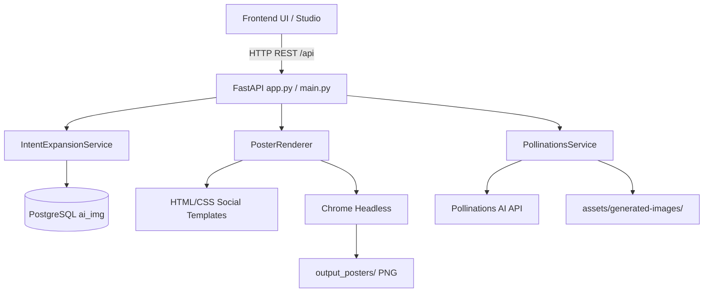

# InfiniteTech AI Poster Studio — Audit & Migration Plan

## 1. Baseline System Audit

### 1.1 Test Suite & Integrity Baseline
Executed on macOS with Python 3.11 and PostgreSQL 18:
- **Total Test Cases**: 18 passed in 21.24s (`pytest tests/ -v`).
  - `tests/test_phase1_reconciliation.py`: 7 passed (immutability, ID preservation, foreign keys, composite keys, char limits, reconciliation report, idempotency).
  - `tests/test_phase2_intent_engine.py`: 5 passed (semantic deduplication $\ge 0.82$, claims filter, intent expansion, caching, review transition).
  - `tests/test_phase3_poster_renderer.py`: 6 passed (contract validation, content generation, 5-template rendering, square rendering, DB persistence, workbook immutability).
- **Source Workbooks**: All 3 Excel workbooks verified 100% byte-for-byte unchanged against verified SHA-256 hashes:
  - `InfinitetechAI_Keyword_Intent_Analysis.xlsx`: `b357fb7bc934cd187387fad3c3308b9aabc1a3d21e0ffd9a65843cff577e6d5a`
  - `InfinitetechAI_Social_SEO_Content.xlsx`: `cf16e84e9b990ea628da54a72d1d8ac19c1674902175b8b85331d63b1c929a74`
  - `InfinitetechAI_Google_Ads_Plan.xlsx`: `8be979b2a62afee03c702dfe2461905a96f5210507591a70559e020802835efa`
- **Database Status**: PostgreSQL `ai_img` contains 46,440 raw rows, 3,816 keywords, 487 shortlisted commercial keywords (`v_commercial_keywords`), and 168 cached search intents.

---

## 2. File Inventory & Layer Classification

| Path | Current Role | Target Layer | Refactoring Action |
| :--- | :--- | :--- | :--- |
| `app.py` | FastAPI application serving REST endpoints and static files | `backend/app/main.py` | Modularize into `backend/app/api/`, keep `app.py` as backward-compatible entrypoint. |
| `engine/models.py` | Intent Pydantic data schemas | `backend/app/schemas/` & `shared/` | Shared data schemas across layers. |
| `engine/similarity.py` | Semantic deduplication engine ($>0.82$ threshold) | `backend/app/services/` | Preserve unchanged in backend services. |
| `engine/claims_filter.py` | Factual validation filter | `backend/app/services/` | Preserve unchanged in backend services. |
| `engine/llm_provider.py` | LLM and heuristic rule providers | `backend/app/services/` | Preserve unchanged in backend services. |
| `engine/intent_service.py` | Search intent expansion orchestrator | `backend/app/services/` | Preserve unchanged in backend services. |
| `engine/poster_models.py` | Strict `PosterContentContract` | `backend/app/schemas/` & `shared/` | Expand with social media platform presets & dimensions. |
| `engine/poster_service.py` | Generates poster copy contracts | `backend/app/services/poster-rendering/` | Integrate with platform format contracts. |
| `engine/renderer.py` | Chrome Headless rendering engine | `backend/app/services/poster-rendering/` | Support 7 social media format presets and dynamic responsive scaling. |
| `importer/read_only_importer.py` | Read-only Excel data importer | `backend/importer/` | Preserve completely. Keep root shim. |
| `database/schema.sql` | PostgreSQL schema definitions | `backend/database/` | Preserve completely. Keep root shim. |
| `templates/*.html` | HTML/CSS poster layouts | `templates/` & `backend/templates/` | **Redesign from A4 document style to bold, punchy social media creatives.** |
| `static/*` | Vanilla JS/CSS frontend UI | `frontend/` | Modularize into feature modules with Pollinations image generation and platform switcher. |
| `assets/*` | Brand assets & thumbnails | `assets/` & `shared/assets/` | Preserve authentic `logo.png` (1913×560) and photography assets. |
| `tests/*` | Pytest regression suite | `backend/tests/` & `tests/` | Preserve existing 18 tests and add tests for social formats and Pollinations service. |

---

## 3. Dependency Graph & Breaking Paths Analysis

### Critical Path Safeguards:
1. **Entrypoint Compatibility**: `python3 -m uvicorn app:app --port 8000` must continue working without friction. We will keep `app.py` at the root as an entrypoint delegating to `backend.app.main:app`.
2. **Pytest Compatibility**: `pytest tests/` must continue discovering and passing all 18 existing tests without path failures.
3. **Template Resolution**: The renderer must resolve templates from both `templates/` and `backend/templates/`.
4. **Asset Resolution**: `logo.png` must remain at the root and in `assets/logo.png`, guaranteed to load with original aspect ratio and clear space.

---

## 4. Visual Reference Analysis: A4 vs Social Media Creative

### The Problem with Current Templates:
- High vertical text density resembling printed enterprise whitepapers or A4 PDF reports.
- Small sub-headings, long descriptive paragraphs, and small numbered lists that are unreadable on mobile social feeds.
- Rigid portrait orientation that breaks when placed on square (Instagram/LinkedIn) or landscape (LinkedIn/X) feeds.

### The Social Creative Standard (Reference Poster `media_1793018859790.png`):
- **Headline Prominence**: 50–70% of upper visual weight dedicated to a massive, punchy, high-contrast headline (e.g. `THE RIGHT CAREER MOVE IN 2026?`).
- **Category Pill / Kicker**: Clean, spaced, uppercase badge (e.g. `DATA SCIENCE`).
- **Action Driver**: Large, saturated, rounded CTA button with bold typography (e.g. `Explore The Program`).
- **Hero Area**: High-impact, authentic photography or product UI with floating glassmorphic pills (`Data Scientist`, `ML Engineer`) rather than a simple square thumbnail.
- **Concise Copy**: One single sentence of supporting context (max 80–120 chars), completely eliminating multi-paragraph clutter.

---

## 5. Supported Social Media Presets

We will implement standard platform presets in `shared/platform-presets/presets.json`:

1. **Instagram Feed Portrait**: `1080 × 1350` (4:5)
2. **Instagram Square**: `1080 × 1080` (1:1)
3. **Instagram Stories / Reels**: `1080 × 1920` (9:16)
4. **LinkedIn Feed Portrait**: `1080 × 1350` (4:5)
5. **LinkedIn Landscape**: `1200 × 627` (~1.91:1)
6. **Facebook Feed Portrait**: `1080 × 1350` (4:5)
7. **X / Twitter Landscape**: `1200 × 675` (16:9)

---

## 6. Pollinations AI Integration Architecture

- **Base URL**: `https://gen.pollinations.ai`
- **Endpoints**: `GET /image/{prompt}` and `POST /v1/images/generations`
- **Model Catalog**: Dynamic discovery via `GET /image/models` (Default: `black-forest-labs/flux.1-schnell` or `tongyi-mai/z-image-turbo`).
- **Authentication**: `POLLINATIONS_API_KEY` stored exclusively in backend `.env`, passed via `Authorization: Bearer <key>`.
- **Composition-Aware Prompts**: Generates clean visual backgrounds or hero subjects without baked-in text, leaving room for deterministic HTML/CSS text rendering on top.
- **Fallback & Storage**: Saves generated images into `assets/generated-images/`. If Pollinations is unavailable, falls back seamlessly to local high-resolution assets (`assets/corporate_hero.jpg`, `assets/product_dashboard.jpg`) or user image upload.

---

## 7. Phased Implementation Roadmap

1. **Phase 1 (Complete)**: Baseline audit, test verification, dependency mapping.
2. **Phase 2**: Structure reorganization into `backend/`, `frontend/`, `shared/` with backward-compatible shims.
3. **Phase 3 & 4**: Redesign the 5 templates as true social-media creatives supporting Portrait (4:5), Square (1:1), Story (9:16), and Landscape (16:9 / 1.91:1).
4. **Phase 5**: Update Studio UI with Platform & Format Preset selector, template selector, and live multi-format preview.
5. **Phase 6**: Backend Pollinations AI service with prompt builder and image caching.
6. **Phase 7 & 8**: Deterministic multi-resolution renderer verification and regression tests.
7. **Phase 9**: Final review and documentation.
